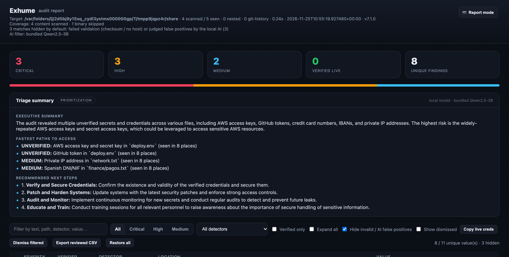

<div align="center">

# 🔎 Exhume

**Unearth buried secrets — and know which ones are real.**

Sensitive-data discovery and verification for security audits and pentests.

[](https://github.com/Sampeerez/exhume/actions/workflows/ci.yml)
[](https://github.com/Sampeerez/exhume/actions/workflows/docker.yml)


[](LICENSE)


</div>

> ⚠️ **Authorized audits only.** Exhume authenticates with the credentials it finds and probes the
> IPs it discovers. Use it only on systems and data you have written permission to test.

## Why Exhume

- **Reads everything**: PDF, Office docs, e-mails, images (OCR), nested archives, executables, and
  databases from the inside — SQLite, dBase, MongoDB dumps, Access — every row and column, not just
  table names.
- **Checks what it finds**: a card, IBAN, DNI or IP that only looks right gets its checksum or
  reachability verified, and anything still ambiguous gets read in context by a local AI.
- **Verifies credentials for real**: live keys and tokens are tested against the actual provider
  API (AWS, GitHub, GitLab, Slack, Stripe…), so a report says which ones genuinely work.
- **Stays on your machine**: scanning, checking and the AI judging it all never leave your laptop —
  see [Privacy](#privacy).

## Install

```bash
pipx install "git+https://github.com/Sampeerez/exhume"
```

No `pipx`? `pip install pipx` (or `brew install pipx`), then rerun the line above. That's the whole
install — everything else (document/archive readers, OCR, the local AI model) sets itself up the
first time it's actually needed.

## Use

```bash
exhume /path/to/target        # scan → HTML report opens automatically
```

```bash
exhume /mnt/share                                  # folder or mounted share
exhume . --git --only-verified                     # repo + full history, show only LIVE credentials
exhume smb://10.0.0.5/Finance --smb-user audit --smb-pass '***'
exhume docker://myapp:latest --sarif               # Docker image
exhume s3://my-bucket/logs                         # S3 bucket
exhume backup.zip --deep                           # archive, exhaustive mode
exhume . --baseline known.json --write-baseline known.json   # re-audit: only what's new
exhume . --mask --no-open                          # client-safe output, don't open the report
```

<details>
<summary><b>All the options</b></summary>

| Option | Effect |
|---|---|
| `--no-ai` · `--ai-gguf FILE` | Disable the AI · use a different `.gguf` model |
| `--no-verify` · `--no-ip-probe` | Fully offline: no credential checks, no IP probing |
| `--only-verified` | Show only LIVE credentials |
| `--mask` | Mask secret values (default shows real ones) |
| `--no-open` · `--no-csv` · `--no-html` · `--json` · `--sarif` | Choose outputs (HTML + CSV by default) |
| `--html-max N` | Findings embedded in the HTML report (default 50 000; the CSV always has all) |
| `--git` / `--no-git-history` | Force / skip Git history |
| `--include` / `--exclude GLOB` | Scope by path (repeatable) |
| `--strings` · `--no-ocr` · `--quick` · `--deep` | Binary strings · OCR off · fast / exhaustive profiles |
| `--rules FILE` · `--allowlist FILE` | Custom rules ([example](rules/example.yaml)) · regexes to ignore |
| `--no-db-peek` · `--db-max-rows N` | Skip database content · rows sampled per table (default 5000) |
| `--no-autoinstall` | Never install anything automatically |

Run `exhume --help` for the full list. Exit code is `1` when a High/Critical finding exists.
</details>

## The report



- **One row per value**, with a `×N` badge and every location it was found in — a password pasted
  into 30 files is one finding, not 30 near-identical rows.
- **Filter by severity, detector or text** — the detector list always matches what's actually
  showing, so you never pick a filter that turns up nothing.
- **Real vs. noise**: invalid matches and AI-flagged false positives are hidden by default, one
  click away from view.
- **Dismiss** anything yourself, with an undo, and export a reviewed CSV when you're done.
- **Report mode**: censors values and hides every control, ready for a client screenshot.
- **Assets** as collapsible folder trees, with an AI-written risk note on every sensitive database.

## Privacy

Everything stays on your machine. The bundled AI model runs in the same process — no network call
involved in judging a finding or writing a summary. If it ever falls back to Ollama, that connection
is refused outright unless it's local (loopback only): pointing it at a remote host disables the AI
instead of sending it data. The only network traffic, ever, is the one-time download of the AI model
itself, before any scan has happened.

Details and tests: [`exhume/ai.py`](exhume/ai.py) (`is_local_url`), [`tests/test_ai.py`](tests/test_ai.py).

<details>
<summary><b>Database engines, in detail</b></summary>

| Engine | Coverage |
|---|---|
| **SQLite** (any extension) | Full — every row/column, embedded files inside BLOBs scanned too. |
| **dBase / xBase** (`.dbf`) | Full. Built in. |
| **MongoDB dumps** (`.bson`) | Full, including nested fields. |
| **MS Access** (`.mdb`, `.accdb`) | Full, if [`mdbtools`](https://github.com/mdbtools/mdbtools) is installed; string-scanned otherwise. |
| **Plain-text SQL dumps** | Scanned as text, same as any file. |
| **MySQL/SQL Server/Redis** raw storage files | String-scanned only — these are a live server's internal format, not something safe to parse offline. |
| Oracle, DB2, Firebird, others | Treated as an ordinary binary file. |
</details>

<details>
<summary><b>Use it in a pipeline</b></summary>

```yaml
# .pre-commit-config.yaml — blocks commits that add High/Critical secrets
repos:
  - repo: https://github.com/Sampeerez/exhume
    rev: main
    hooks:
      - id: exhume
```

```yaml
# GitHub Actions — fails the job on High/Critical findings
- run: pipx run --spec "git+https://github.com/Sampeerez/exhume" exhume . --no-open --no-csv --no-ai --no-verify --min-sev high
```
</details>

<details>
<summary><b>Development</b></summary>

```bash
git clone https://github.com/Sampeerez/exhume && cd exhume
python3 -m venv .venv && source .venv/bin/activate
pip install -e ".[full]"   # or just -e . — extras still auto-install as needed

make test   make lint   make demo   make report-demo   # pytest · ruff · regenerate the two GIFs
```

```
exhume/
├── scanner.py      engine (multiprocessing, per-file timeout, coverage counters)
├── detectors/      patterns · entropy · validators (IBAN/card/DNI/IP) · custom rules
├── extractors/     documents · archives · OCR · databases · magic bytes
├── sources/        filesystem · git history · SMB · Docker · S3
├── verify/         credential verifiers (provider APIs) · IP liveness
├── ai_filter.py    bundled local AI: judges matches & assets, verdict cache
├── ai.py           triage summary (bundled model, or local Ollama)
└── reporting/      console · html · json · csv · sarif
```

Also ships as a Docker image (`docker build -t exhume .`) with everything bundled.
</details>

## Legal

For **security professionals performing authorized audits** only. You are solely responsible for
having explicit written authorization over the systems and data you analyze.

MIT licensed — see [LICENSE](LICENSE).
